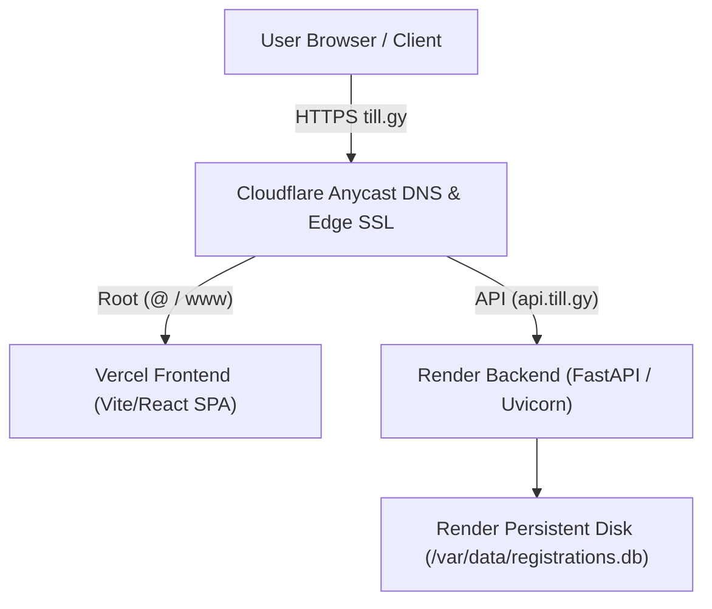

# Domain Connection Guide: till.gy

## ⚠️ Important Status Notice: Allocation Pending

> **Status:** The registration request for **`till.gy`** is currently pending official allocation with the University of Guyana .GY Registry.
>
> **Do not modify or commit active DNS delegations until ownership and allocation are officially verified** by the .GY Registry / accredited registrar. Premature DNS propagation attempts on unallocated ccTLD names can result in routing blackholes or hijack risks.

---

## Architecture Overview

Once `till.gy` is allocated, the production deployment is architected as follows:



---

## Required DNS Records (Cloudflare DNS Management)

Once nameserver authority is delegated to Cloudflare:

| Type | Name / Host | Target / Value | Proxy Status | Description |
| :--- | :--- | :--- | :--- | :--- |
| **A** | `@` (`till.gy`) | `76.76.21.21` | Proxied / DNS Only | Points apex domain to Vercel Edge Network |
| **CNAME** | `www` | `cname.vercel-dns.com` | Proxied / DNS Only | Routes `www.till.gy` to Vercel |
| **CNAME** | `api` | `<your-backend-slug>.onrender.com` | DNS Only (or Proxied) | Routes `api.till.gy` to Render FastAPI service |

> [!NOTE]
> When using Cloudflare SSL with Vercel and Render, set Cloudflare SSL mode to **"Full (strict)"** so traffic between Cloudflare edge and Vercel/Render origins remains fully encrypted with valid certificates.

---

## Step-by-Step Production Activation

### Step 1: Confirm Registry Allocation
- Verify receipt of confirmation from the University of Guyana .GY Registry or authorized registrar partner.
- Ensure the WHOIS record reflects the authorized registrant contact.

### Step 2: Set Nameservers at the Registrar
- In the registrar portal, point the domain's primary nameservers to your assigned Cloudflare nameservers (e.g., `ada.ns.cloudflare.com` and `beau.ns.cloudflare.com`).

### Step 3: Link Custom Domain in Vercel
1. Open your Vercel Project Dashboard -> **Settings** -> **Domains**.
2. Add `till.gy` and select "Redirect www.till.gy to till.gy" (or configure both).
3. Vercel will verify DNS records and issue an automated Let's Encrypt certificate.

### Step 4: Link Custom Domain in Render
1. Open your Render Web Service Dashboard -> **Settings** -> **Custom Domains**.
2. Add `api.till.gy`.
3. Render will verify the CNAME record and provision an SSL certificate.

### Step 5: Update Production Environment Variables

#### Render Backend Environment:
- `CORS_ORIGINS`:
  ```json
  ["https://till.gy", "https://www.till.gy", "https://mastertools-domains.vercel.app"]
  ```

#### Vercel Frontend Environment:
- `VITE_API_BASE_URL`:
  ```
  https://api.till.gy
  ```
  *(Or `https://<service-name>.onrender.com` until `api.till.gy` DNS finishes propagating).*
